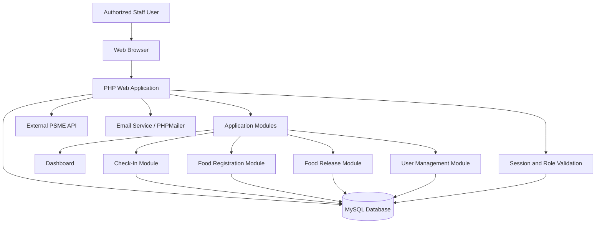

# Check in System Documentation

## I. Project Overview

**Project Name:** Check in system

**Version:** 1.0

**Prepared By:** John Julius Baldia

**Date:** March 19, 2026

**Department / Team:** ICTO

**Project Sponsor / Owner:** John Julius Baldia, IT Consultant / Project Owner

### Description

The Check in system is a web-based event operations platform used to support convention registration validation, attendee check-in, kit release monitoring, food registration management, and food distribution tracking for the PSME national convention workflow.

The system addresses operational bottlenecks that normally occur during event registration and on-site attendee servicing by centralizing attendee lookup, QR-based verification, role-based staff access, dashboard monitoring, and release-history tracking in one administrative platform. It is designed to reduce manual encoding, prevent duplicate food releases, improve accountability, and provide real-time visibility into event operations.

## II. Objectives

- Provide a centralized system for attendee check-in, search, and registration validation.
- Support QR-based and search-based operational workflows for faster convention servicing.
- Track food registration and daily food release transactions with duplicate prevention.
- Manage authorized system users through role-based access and administration tools.
- Provide dashboard summaries for check-ins, kit releases, food registration, and food release activity.
- Maintain an auditable record of operational actions performed by authorized staff.

### Expected Outcomes

- Faster attendee processing during convention operations.
- Reduced manual errors in check-in and food distribution.
- Clear accountability for who performed operational transactions.
- Better monitoring of convention activity through dashboard and tabular views.
- Improved data consistency across user, attendee, and release records.

### Business/Organizational Value

- Improves service efficiency during high-volume event operations.
- Reduces operational risk caused by duplicate releases and inconsistent manual records.
- Supports management reporting and post-event validation.
- Strengthens operational control through authenticated access and defined staff responsibilities.

## III. Scope of the System

### In Scope

- User authentication and session management.
- Password recovery workflow.
- Dashboard for event metrics and quick navigation.
- QR code-based attendee check-in.
- Search-based attendee lookup for check-in operations.
- Check-in record listing and management.
- Food registration listing, creation, update, deletion, and mapping management.
- Food release by QR scan and by search.
- Food release history and day-based release status tracking.
- User administration for authorized personnel.
- Role-based menu visibility and permission checks.
- Test-mode controls related to food release schedule validation.

### Out of Scope

- Public self-service attendee registration portal.
- Payment collection and financial reconciliation.
- SMS gateway integration.
- Full document management or records archival system.
- Native mobile application.
- Automated infrastructure provisioning and CI/CD pipelines.
- Multi-event calendar management beyond the currently configured convention workflow.

## IV. Stakeholders

| Role | Name | Responsibility |
|------|------|----------------|
| Project Owner | John Julius Baldia | Owns the system direction, approves implementation priorities, and represents business/technical ownership. |
| System Developer | John Julius Baldia / ICTO Team | Maintains source code, database logic, deployment updates, and technical issue resolution. |
| Approving Authority | Project Owner / Department Head / End-User Representative / PSME National President | Reviews scope, validates readiness, and authorizes implementation or production use. |
| End Users | Authorized convention staff | Use the system for check-in, food distribution, lookup, and operational monitoring. |

## V. System Requirements

### A. Functional Requirements

1. **User Registration/Login**
   - The system shall allow authorized users to log in using username and password.
   - The system shall validate credentials against stored user records.
   - The system shall create an authenticated session before allowing access to protected pages.
   - The system shall support password reset and recovery workflows through email-based processes.

2. **Dashboard**
   - The system shall display role-aware operational dashboard cards.
   - The system shall show check-in, kit-release, food-registration, and food-release metrics.
   - The system shall provide navigation shortcuts to scanning, searching, and data-management modules.

3. **Check-In Management**
   - The system shall support QR scanning using a camera-based scanner.
   - The system shall support scanner-device input and manual search workflows.
   - The system shall retrieve registrant details for validation before recording check-in.
   - The system shall record timestamps and status updates for check-in and kit release.

4. **Food Registration Management**
   - The system shall list all food registrants in a searchable tabular interface.
   - The system shall allow authorized users to add, update, and delete food registrations.
   - The system shall support mapping of food registration records to external attendee data.

5. **Food Release Management**
   - The system shall allow food release by QR scan and by search.
   - The system shall prevent duplicate food releases for the same registrant on the same release date.
   - The system shall store release date, release time, and releasing user details.
   - The system shall show daily or cumulative release status for each registrant.

6. **User Management**
   - The system shall allow administrative users to create and delete users.
   - The system shall support role assignment and permission-based menu access.
   - The system shall maintain user account data including username, email, role, and last login.

7. **Reports Generation and Data Retrieval**
   - The system shall provide DataTables-compatible server-side endpoints for operational listings.
   - The system shall support export-ready or fetch endpoints for food and check-in data.
   - The system shall support release-status inspection and search results retrieval.

8. **Notifications**
   - The system shall display in-page success and error messages for user actions.
   - The system shall support password reset email notifications.
   - The system shall provide visible release-status and convention-status indicators during food distribution.

### B. Non-Functional Requirements

- **Performance:** The system should return dashboard widgets and tabular data within acceptable operational response times for event use, typically within 2 to 5 seconds under normal load.
- **Security:** The system must enforce authentication, session validation, password hashing, prepared SQL statements, and restricted access based on user role or permission.
- **Scalability:** The system should support increased record volume through indexed database tables and server-side pagination, while remaining suitable for convention-scale operations.
- **Availability:** The system should be available throughout event operations, with hosting, backup, and recovery controls sufficient for business continuity during convention dates.
- **Maintainability:** The system should allow administrators or developers to update configurations, release dates, and setup scripts with minimal code disruption.
- **Usability:** The system should remain accessible on desktop and mobile-responsive browser views used by staff in live event environments.

## VI. System Architecture

### A. Overview

The system follows a web-based client-server architecture. End users access PHP-rendered web pages through a browser. The application uses session-based authentication, role-aware navigation, AJAX-powered data tables, QR-scanning interfaces, and MySQL-backed transaction storage.

Operationally, the application is structured around page-level modules such as dashboard, check-in, food release, and user management. Shared components such as navigation, top bar, and utility functions are reused across authenticated pages. The backend communicates with both the local database and an external PSME API for specific attendee or token-related operations.

### B. Technology Stack

- **Frontend:** HTML5, CSS, Bootstrap 4, SB Admin 2 theme assets, JavaScript, jQuery, DataTables, Feather Icons, html5-qrcode
- **Backend:** PHP (procedural page-controller style), cURL-based API calls, PHP sessions
- **Database:** MySQL / MariaDB
- **Hosting:** cPanel web hosting for official deployment; local XAMPP-style environment for development and testing
- **Build / Asset Tooling:** npm, Gulp, SCSS asset pipeline
- **Mailing / Utilities:** PHPMailer and utility scripts for password reset and support functions

### C. Architecture Diagram

If a formal Visio, PNG, or PDF architecture diagram is required, this section should be replaced with an approved project diagram.

## VII. Database Design

### ERD (Entity Relationship Diagram)

The current repository documents a relational design centered on users, roles, check-ins, food registrations, and food releases. The main entity relationships are summarized below:

- `users` stores system accounts.
- `roles`, `permissions`, `user_roles`, and `role_permissions` support access control.
- `checkins` stores attendee check-in and kit-release activity.
- `food` stores food registration records.
- `food_releases` stores daily release transactions linked to `food` and `users`.
- `food_releases_view` and `food_release_status` provide reporting-friendly views.

### Table Structures

| Table | Purpose |
|------|---------|
| `users` | Stores system user credentials, emails, access tokens, timestamps, and role-related information. |
| `roles` | Stores available role definitions used by access-control logic. |
| `permissions` | Stores named permissions used for menu and function access checks. |
| `user_roles` | Maps users to assigned roles. |
| `role_permissions` | Maps permissions to roles. |
| `checkins` | Stores attendee identity details, QR code, status, check-in time, and kit-release time. |
| `food` | Stores food registration records and mapping values for attendee correlation. |
| `food_releases` | Stores food-release transactions per registrant per date, including releasing user. |
| `test_config` | Stores test-mode or date override settings used during food-release testing. |

### Key Fields and Relationships

- `users.id` or implementation-specific user key is used to identify authenticated users.
- `food.id` is the parent key for food release transactions.
- `food_releases.food_id` references `food.id`.
- `food_releases.released_by` references the system user who processed the release.
- `checkins.status` tracks progression such as pending, checked_in, and kit_released.
- `food_releases` enforces a unique `(food_id, release_date)` rule to prevent duplicate daily releases.
- Role and permission tables are used by helper functions to evaluate access rights at runtime.

## VIII. User Roles and Permissions

| Role | Access Level |
|------|--------------|
| Admin | Full access to dashboard, check-in, food release, user management, and test controls. |
| Check-In Staff | Access to dashboard, QR scan, attendee search, and check-in list management. |
| Food Distributor | Access to food release by scan, food release by search, and food distribution list. |
| Standard User / Legacy User Record | Limited or role-dependent access based on assigned permissions and configuration. |

## IX. System Features / Modules

### 1. User Management Module

- Create and delete users.
- Assign roles and permission-based access.
- Maintain login-related account records.
- Support password reset and email-based recovery.

### 2. Authentication Module

- Username and password login.
- Session management and protected-page validation.
- External token retrieval for API-dependent functionality.
- Logout and token lifecycle handling.

### 3. Dashboard Module

- Displays operational metrics for check-ins, kit release, food registration, and food release.
- Provides quick links to scanning, searching, and record-management functions.
- Adapts visible content based on user role.

### 4. Check-In Module

- QR scan-based attendee identification.
- Search-based attendee lookup.
- Check-in confirmation and recording.
- Kit-release status tracking.

### 5. Food Registration Module

- Add, edit, delete, and list food registrants.
- Maintain mapping data for attendee correlation.
- Display release-related status columns for staff use.

### 6. Food Release Module

- Release food via QR scan.
- Release food via search.
- Prevent duplicate same-day release.
- Record release history and releasing staff.
- Show convention date status and release eligibility.

### 7. Search and Retrieval Module

- Search attendees by QR code, name, email, or identifier depending on workflow.
- Retrieve release status and check-in related details.
- Support DataTables server-side filtering and paging.

### 8. Testing and Configuration Module

- Supports food test controls and date-based test behavior.
- Includes setup and schema verification scripts for controlled initialization and testing.

## X. User Interface (UI/UX) Design

### Screenshots / Mockups

- Login page: pending screenshot attachment.
- Dashboard page: pending screenshot attachment.
- Check-in scan page: pending screenshot attachment.
- Food release scan page: pending screenshot attachment.
- User management page: pending screenshot attachment.

### Navigation Flow

1. User opens the login page.
2. System authenticates user credentials and initializes a session.
3. User is redirected to the dashboard.
4. Available menus are displayed according to assigned role.
5. User performs check-in, food release, search, or management tasks.
6. System stores transactions and updates dashboard and listing data.

### User Experience Considerations

- Responsive layout suitable for desktop and mobile browsers.
- Card-based dashboard navigation for common tasks.
- QR scan workflow designed for fast live-event processing.
- Search alternatives provided when scan-based lookup is unavailable.
- Status indicators and validation messages are visible during operational use.

## XI. Security Measures

- **Authentication:** Username/password login with session-based access control.
- **Authorization:** Role-based and permission-based access checks on navigation and protected functionality.
- **Password Protection:** Passwords are stored as hashed values.
- **Database Security:** Prepared statements are used in key database operations to reduce SQL injection risk.
- **Data Protection:** Sensitive operational access is limited to authenticated users; production deployment should additionally enforce secure transport, server hardening, and database backup controls.
- **Audit Trail:** Check-in and food-release records maintain timestamps and operational attribution.
- **Session Validation:** Protected modules redirect unauthenticated users back to login.
- **Operational Constraint:** Hardcoded credentials and event dates observed in the current codebase should be refactored or secured as part of production hardening.

## XII. Testing Plan

### A. Testing Types

- **Unit Testing:** Validate discrete backend functions and data validations where feasible.
- **Integration Testing:** Validate login, API token retrieval, QR lookup, check-in recording, food release recording, and dashboard updates across modules.
- **User Acceptance Testing (UAT):** Validate real staff workflows during pre-event simulation and controlled operational testing.
- **Regression Testing:** Re-test core workflows after changes to authentication, schema, release logic, or role configuration.
- **Security Testing:** Validate session restrictions, unauthorized access handling, and password-reset behavior.

### B. Test Cases

| Test Case | Description | Expected Result |
|----------|-------------|-----------------|
| Login Test | Valid credentials | Access granted and session created |
| Invalid Login Test | Invalid username or password | Access denied with error message |
| Session Protection Test | Open protected page without session | Redirect to login page |
| Check-In Scan Test | Scan valid attendee QR code | Attendee details retrieved and check-in can be recorded |
| Check-In Search Test | Search attendee by available identifiers | Matching attendee record displayed |
| Food Release Test | Release food for eligible attendee | Release saved with timestamp and releasing user |
| Duplicate Food Release Test | Attempt second release on same day | Transaction blocked by validation or unique constraint |
| User Creation Test | Admin creates a new user | User record saved successfully |
| Password Reset Test | Submit valid email for recovery | Reset process triggered and feedback provided |
| Dashboard Metrics Test | Load dashboard after transactions | Updated counts and cards displayed correctly |

## XIII. Deployment Plan

### Deployment Environment

- **Official Target:** cPanel web hosting
- **Development / Testing Reference:** Local PHP/MySQL environment similar to XAMPP

### Steps to Deploy

1. Prepare the hosting environment with supported PHP and MySQL versions.
2. Create the production database and database user with proper privileges.
3. Import required schema objects and convention-related tables.
4. Update database connection settings for the target environment.
5. Upload application files to the cPanel hosting account.
6. Configure writable directories and email settings if required.
7. Verify login, dashboard, check-in, food release, and user-management workflows.
8. Validate external API connectivity and token retrieval.
9. Conduct smoke testing before releasing the system to operational users.

### Rollback Plan

1. Maintain a backup copy of the previous application package.
2. Keep a current database backup before deploying any changes.
3. If deployment fails, restore the previous code package.
4. Restore the last known good database backup if schema or data changes caused failure.
5. Re-run smoke tests after rollback to confirm service restoration.

## XIV. Maintenance and Support

### Bug Fixing Process

1. Log issue details and affected workflow.
2. Reproduce the problem in a controlled environment.
3. Apply and test the fix.
4. Validate that the fix does not break check-in, food release, or user access flows.
5. Deploy the fix following change-control procedures.

### System Updates

- Update event dates, release rules, API credentials, and role configurations as needed.
- Review database schema when adding or changing operational modules.
- Keep frontend dependencies and PHP libraries aligned with hosting requirements.

### Technical Support Contact

- **Primary Support:** John Julius Baldia / ICTO
- **Escalation:** Department Head or designated technical authority

## XV. Risk Management

| Risk | Impact | Mitigation |
|------|--------|------------|
| System Downtime | High | Maintain hosting support access, backups, and rollback-ready deployment packages. |
| Database Misconfiguration | High | Use environment-specific connection settings and validate deployment credentials before go-live. |
| Duplicate or Incorrect Release Entries | High | Enforce unique release rules, role restrictions, and pre-release validation checks. |
| External API Unavailability | Medium to High | Provide fallback search/manual workflows and monitor token/API connectivity. |
| Hardcoded Configuration Values | High | Move credentials, dates, and sensitive settings into controlled configuration management. |
| Unauthorized Access | High | Strengthen session validation, role checks, password handling, and hosting security controls. |
| Data Loss | High | Schedule routine database backups and verify restoration procedures. |
| User Error During Live Operations | Medium | Provide training, workflow guides, and pre-event rehearsal sessions. |

## XVI. Documentation and Training

- **User Manual:** To cover login, check-in, search, food release, and record-management workflows.
- **Admin Guide:** To cover user management, deployment configuration, role administration, and maintenance procedures.
- **Training Sessions:** Recommended for check-in staff, food distributors, and administrators before production event use.
- **Operational Reference Materials:** Quick guides for scan-based and search-based workflows should be prepared for live event staff.

## XVII. USER APPROVAL TO IMPLEMENT

### Approval Statement

This document confirms that the undersigned stakeholders have reviewed the proposed system, including its features, scope, and implementation plan.

By signing below, they authorize the development team to proceed with the implementation and deployment of the system.

### Approval Details

| Name | Position | Signature | Date |
|------|----------|-----------|------|
| TBA | Project Owner |  |  |
| TBA | Department Head |  |  |
| TBA | ICT / Technical Head |  |  |
| TBA | End-User Representative |  |  |
| TBA | PSME National President |  |  |

### Remarks / Conditions (if any)

To be completed during formal review.

### Final Approval

- [ ] Approved for Implementation
- [ ] Approved with Conditions
- [ ] Not Approved

## XVIII. Revision History

| Version | Date | Description | Author |
|---------|------|-------------|--------|
| 1.0 | March 19, 2026 | Initial Draft | John Julius Baldia |

## Notes and Assumptions

- This document is based on the current repository state and supporting schema documentation available at the time of review.
- The repository shows both local-development settings and a hosted deployment target; final production configuration should be formalized before go-live.
- Screenshots, signed approval pages, and formally approved architecture or ERD assets are pending and should be attached in the final controlled version of this document.